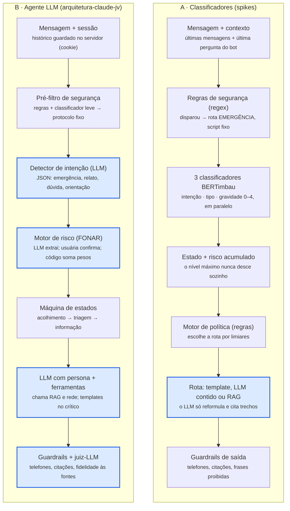

# Comparação de arquiteturas do chatbot

08/10/2026 · João Vitor

> **Complemento:** a comparação com o baseline de LLM estruturada, agentes com ferramentas e modelos System One está em [docs/arquitetura-agentica.md](docs/arquitetura-agentica.md). O documento preserva esta comparação e acrescenta as alternativas que não dependem de treinar classificadores próprios.

## Resumo

A arquitetura B (agente LLM) é a única que cabe inteira até a apresentação de 27/nov com 3 pessoas; a A (classificadores) é mais previsível nas decisões, mas precisa de cerca de 11 mil exemplos anotados e não cabe no prazo. Recomendação: uma **híbrida** (estrutura da B com um classificador de intenção treinado), se o grupo tiver 4 pessoas ou aceitar os cortes da seção Opção híbrida.

| Critério | A — Classificadores | B — Agente LLM | Híbrida |
| --- | --- | --- | --- |
| Esforço total estimado | ~122 dias-pessoa | ~81 dias-pessoa | ~96 dias-pessoa |
| Cabe até 19/nov com 3 pessoas (81 d) | Não (precisa de ~5 pessoas) | No limite | Com 4 pessoas ou com cortes |
| Dinheiro (modelo local + Colab) | R$ 0 | R$ 0 | R$ 0 |
| Chamadas ao LLM por mensagem | 1–2 | 3–4 | 2–3 |
| Modelos treinados | 3 | 0 | 1 |
| Como o risco é calculado | Modelo ordinal aprendido dos dados | Questionário FONAR com pesos, em código | Questionário FONAR com pesos, em código |
| Maior risco | Volume de anotação | Qualidade do LLM local; pesos sem validação | Os dois, em menor grau |

Estimativas aproximadas (±30%), detalhadas nas seções Tempo, Dinheiro e Performance.

## Visão geral

As duas usam regras fixas para emergência e RAG para dúvidas jurídicas; a diferença é **quem entende a mensagem e quem calcula o risco**. Na A, modelos treinados; na B, o LLM entende e um questionário com pesos calcula.

- **A — Classificadores** (`spikes/arquitetura_chatbot_violencia_genero_IA.md`): três BERTimbau ajustados classificam cada mensagem, regras decidem a rota e o LLM só reformula e cita trechos.
- **B — Agente LLM** (`arquitetura-claude-jv/agente.md`): "o LLM conversa; o código decide". O LLM conduz a conversa e chama ferramentas: motor de risco, RAG e rede de serviços.

| Componente | A — Classificadores | B — Agente LLM |
| --- | --- | --- |
| Emergência | Regras (regex + léxico) antes de tudo | Pré-filtro: regras + classificador leve antes do LLM |
| Intenção | BERTimbau: dúvida, relato, emergência | LLM com saída JSON + regras de reserva; inclui orientação geral e ambígua |
| Tipo de violência | BERTimbau multilabel (5 tipos da Lei Maria da Penha) | Dimensões calculadas pelo motor de risco |
| Gravidade / risco | BERTimbau ordinal, níveis 0–4 | Itens do FONAR/Violentômetro com pesos e pisos por fator crítico |
| Memória da conversa | Risco acumulado: o nível máximo só desce com confirmação | Máquina de estados + histórico de escores |
| Decisão da resposta | Motor de política com limiares | Máquina de estados + regras |
| Texto da resposta | Templates; LLM só no acolhimento e no RAG | LLM com persona em todo turno; templates nos trechos críticos |
| Dúvidas jurídicas | RAG com citação e recusa | RAG com citação e recusa |
| Verificação da saída | Telefones, citações, frases proibidas, reclassificação da resposta | Telefones, citações, lista "nunca faça", juiz de fidelidade (LLM) |
| Dados a construir | 3 datasets anotados (~11 mil exemplos) | Gabarito do RAG (150–300 perguntas) + vinhetas de risco |

## Como cada uma funciona

Nas duas, uma emergência é respondida por regras fixas antes de qualquer modelo; a diferença está no caminho de uma mensagem comum.

Cada linha alinha etapas equivalentes; as caixas destacadas são as que dependem do LLM. Na A o LLM só entra na resposta; na B ele entra em quatro etapas.

| Mensagem | A — Classificadores | B — Agente LLM |
| --- | --- | --- |
| "ele quebrou a porta, to escondida com meu filho" | Regras disparam antes de tudo → rota de emergência com texto fixo (190, 180, 192). Sem LLM. | Pré-filtro dispara antes do LLM → protocolo de emergência fixo; sessão marcada como CRÍTICO. Sem LLM. |
| "o que é medida protetiva?" | Classificador: dúvida → RAG busca artigos → LLM redige só com os trechos, com citação → verificação. | LLM detecta dúvida → RAG busca artigos → LLM com persona redige com citação → guardrails e juiz conferem. |
| "ontem ele me empurrou de novo e disse que se eu sair ele me mata" | Classificadores: relato, física + psicológica, gravidade 3; a regra de ameaça de morte põe piso 3 → acolhimento de risco alto: LLM valida, canais por template e uma pergunta ("Você está em um lugar seguro agora?"). | LLM detecta relato e extrai "ameaça de morte" e "agressão física" como inferidos → acolhe e pede licença → confirma ("Ele já ameaçou te matar?") → motor aplica o piso → nível alto em linguagem simples + Violentômetro + canais. |

A diferença central: a A classifica o texto livre sem perguntar; a B pergunta e só pontua o que a usuária confirma.

## Tempo

Com 3 pessoas há cerca de **81 dias-pessoa** entre 13/out e 19/nov (27 dias úteis, até o fim dos testes); a B usa ~81, a híbrida ~96 e a A ~122.

| Bloco de trabalho | A | B | Híbrida |
| --- | --- | --- | --- |
| Comum: fundamentos, backend, frontend, RAG, guardrails, rede/geo, testes | 71,5 d | 71,5 d | 71,5 d |
| Dados específicos | ~37 d (guia + 3 datasets) | ~2 d (transcrever itens do FONAR) | ~13 d (itens do FONAR + dataset de intenção reduzido) |
| Modelos e motores específicos | ~13,5 d (3 fine-tunings, baseline, calibração, ablação) | ~7 d (motor de risco + prompts de intenção e extração) | ~11,5 d (motor de risco, extração, 1 fine-tuning, calibração) |
| **Total** | **~122 d** | **~81 d** | **~96 d** |

Capacidade até 19/nov: 2 pessoas = 54 d · 3 pessoas = 81 d · 4 pessoas = 108 d · 5 pessoas = 135 d. O bloco comum vem das tarefas do `cronograma.md`.

- **Como os dados da A foram estimados:** os spikes propõem 3.200 + 4.500 + 3.300 exemplos. A ~1,5 min por exemplo entre escrita e anotação, são ~275 horas, ou ~34 dias de 8 h, além do guia. A gravidade ainda pede 3 anotadores e um especialista para calibrar a escala.
- **O que dá para reduzir na A:** começar com menos exemplos e parar quando a curva de aprendizado estabilizar. Mesmo assim, ter três modelos até 6/nov é o ponto mais arriscado do cronograma.
- **Onde a B gasta tempo que não aparece na tabela:** ajustar prompts até o LLM local devolver JSON correto, e esperar a validação dos pesos pelo especialista.

## Dinheiro

As três opções podem custar **R$ 0** com modelo aberto rodando localmente e treino no Colab gratuito. A B é a que mais encarece se o grupo usar uma API paga, porque chama o LLM 3–4 vezes por mensagem.

| Item | A — Classificadores | B — Agente LLM | Observação |
| --- | --- | --- | --- |
| Treino | Colab gratuito | Não há treino | Sessões do Colab expiram: salvar checkpoints no Drive |
| Licença dos modelos | BERTimbau (aberto) + LLM aberto | LLM aberto | Qwen 2.5 e Mistral: Apache 2.0 na maioria dos tamanhos; Llama 3.x: licença comunitária; Gemma: termos próprios. Conferir antes de escolher |
| LLM rodando local | R$ 0 | R$ 0, com mais carga na máquina | O spike estima ~5 GB para um modelo de 7–8B em 4 bits e 10–20 GB para o sistema todo |
| LLM por API paga | Baixo: 1–2 chamadas por mensagem | 2 a 3 vezes maior: 3–4 chamadas | Exige contrato sem retenção e sem treino com os dados (E8) |
| Planos gratuitos de API | Só com dados sintéticos | Só com dados sintéticos | Costumam ter limite de uso e podem usar os dados enviados |
| Hospedagem da demo | Máquina do grupo ou créditos de nuvem | Idem | O E10 cita créditos de Oracle, AWS, Microsoft e Cloudera: confirmar o que cobrem |
| Especialistas | Calibrar a escala de gravidade | Validar os pesos do FONAR | Custo em tempo, não em dinheiro |

O custo real da B não é financeiro, é de qualidade: modelos locais pequenos seguem pior o prompt e erram mais o JSON, e a B depende disso em mais etapas.

## Performance

A A deve ser mais rápida e mais previsível por mensagem; a B conversa melhor e explica o risco item a item, mas depende mais da qualidade do LLM. Nenhum número abaixo foi medido: são estimativas a confirmar no protótipo.

| Aspecto | A — Classificadores | B — Agente LLM |
| --- | --- | --- |
| Tempo de resposta | Classificadores em dezenas de ms + 1 geração curta (alguns segundos) | 3–4 chamadas ao LLM em sequência: alguns segundos a mais por mensagem |
| Emergência | Regras + modelo com limiar ajustável (ex.: P > 0,30); recall medido no teste ouro | Regras antes do LLM; o LLM não devolve probabilidade calibrada, então o limiar é menos controlável |
| Gravidade | Lê o texto livre sem perguntar; o análogo WomenHelp chegou a macro-F1 ~0,58 em 4 níveis | Reproduzível e auditável; depende de a usuária responder às perguntas |
| Explicação do risco | Parcial (só com a versão que também prevê fatores de risco) | Total: lista os itens que levaram ao nível |
| Alucinação | Menor superfície: LLM só no acolhimento e no RAG | Maior superfície: texto gerado em todo turno, mitigado por guardrails e juiz |
| Mesma entrada, mesma saída | Sim nos classificadores e nas regras | Sim no motor de risco; não no LLM (temperatura baixa reduz a variação) |
| Linguagem ruidosa (gírias, sem acento) | Depende da diversidade do dataset | LLMs costumam lidar bem; modelos pequenos, menos |
| Fluidez da conversa | Mais rígida, mais templates | Mais natural |
| Experiência da usuária | Não faz questionário | Faz perguntas, uma por turno: pode cansar ou assustar |

Para medir no protótipo, nas duas: latência por etapa, recall de emergência nas vinhetas, taxa de JSON válido do LLM (B) e taxa de alucinação no gabarito do RAG.

## Prós e contras

A A ganha em controle e em resultados mensuráveis; a B ganha em prazo, em explicação do risco e em fluidez.

**A — Classificadores**

- A favor: decisões de risco vêm de modelos medidos com métricas claras (recall, QWK) e limiares ajustáveis.
- A favor: depende pouco do LLM e funciona até sem ele, com respostas só por template.
- A favor: mais rápida por mensagem e mais barata se houver API.
- A favor: entrega três modelos treinados e avaliados.
- Contra: ~11 mil exemplos anotados; não cabe até 27/nov com 3 pessoas.
- Contra: gravidade é subjetiva, e o desempenho fica limitado pela concordância entre anotadores.
- Contra: o modelo pode aprender o estilo dos dados sintéticos em vez do conceito.
- Contra: conversa mais rígida.

**B — Agente LLM**

- A favor: cabe no prazo com 3 pessoas, no limite.
- A favor: risco baseado em instrumento oficial (FONAR), reproduzível e explicável.
- A favor: conversa mais natural e reconhece mais intenções (orientação geral, ambígua).
- A favor: pouco dado a construir (gabarito do RAG e vinhetas).
- Contra: nenhum modelo treinado; se o projeto exigir um, não atende.
- Contra: depende da qualidade do LLM em quatro etapas; um modelo local pequeno pode falhar no JSON.
- Contra: mais lenta por mensagem e mais cara se usar API.
- Contra: os pesos do FONAR precisam de especialista; sem isso, ficam provisórios.
- Contra: o questionário pode cansar a usuária.

## Opção híbrida

A híbrida usa a estrutura da B e troca a detecção de intenção por um BERTimbau treinado: ~96 dias-pessoa, que cabem com 4 pessoas; com 3, os cortes abaixo reduzem ~10 d e ainda faltam ~5 d.

| Peça | Vem de |
| --- | --- |
| Regras de emergência antes de tudo | A e B |
| Classificador de intenção BERTimbau, com limiar de emergência ajustável | A |
| LLM como segunda opinião quando o classificador está incerto | B |
| Motor de risco com itens do FONAR, pesos e pisos por fator crítico | B |
| Extração de fatos pelo LLM, com confirmação da usuária | B |
| Risco acumulado na conversa (o nível máximo não desce sozinho) | A |
| RAG com citação, recusa e guardrails | A e B |

Por que vale: entrega um modelo treinado e avaliado onde ele mais importa, que é detectar emergência, e mantém o risco explicável. Também tira uma chamada de LLM por mensagem em relação à B.

Cortes possíveis com 3 pessoas (áudio e camuflagem completa já estão fora da estimativa):

1. Reranqueamento do RAG (~2 d).
2. GPS na geolocalização, mantendo só cidade/CEP (~1,5 d).
3. Dataset de intenção menor, ~1.000 exemplos (~3 d).
4. Juiz-LLM de fidelidade trocado por validadores determinísticos (~2 d).
5. Testes de usabilidade só com colegas (~1 d).

## Próximos passos

A decisão sai no ADR de 14/10/2026; antes disso, as respostas abaixo podem mudar a escolha.

- [ ] Confirmar quantas pessoas trabalham no projeto (define se a híbrida cabe sem cortes)
- [ ] Verificar se a especificação do Projeto Integrador exige um modelo treinado e avaliado (se sim, a B pura não atende)
- [ ] Testar 2–3 LLMs abertos com o prompt de extração e ~20 vinhetas, medindo a taxa de JSON válido e correto (decide se a B funciona sem custo)
- [ ] Confirmar se há especialista para validar os pesos do FONAR e revisar os textos de emergência
- [ ] Confirmar o que os créditos de nuvem do desafio cobrem
- [ ] Registrar a decisão no ADR

Riscos que valem para qualquer escolha: dados de serviços desatualizados, conteúdo sensível sem revisão especializada e demo ao vivo dependente da velocidade do LLM (ter vídeo gravado como plano B).
