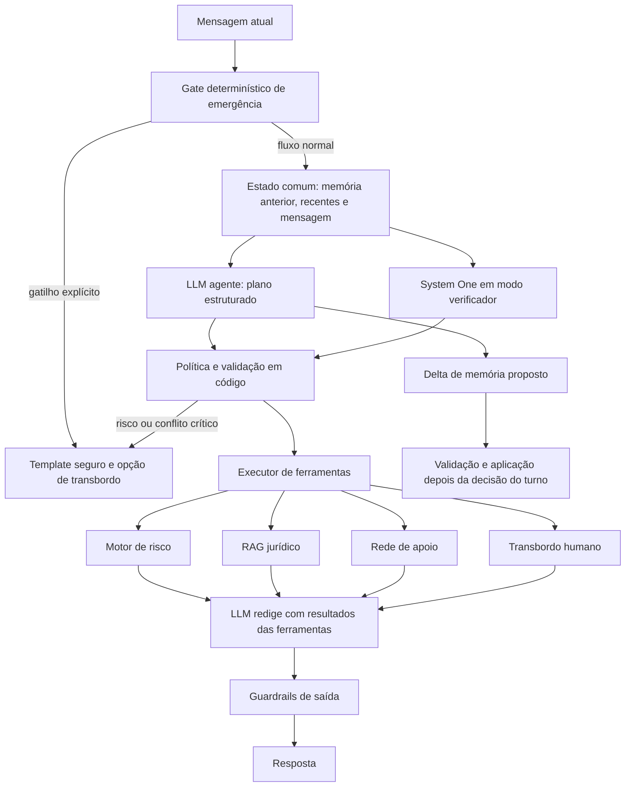

# Arquitetura agêntica com LLM e ferramentas

## 1. Relação com o baseline de classificação

Uma LLM usada como classificador recebe um estado e devolve rótulos estruturados. Uma LLM usada como agente recebe o mesmo estado, mas também propõe a próxima ação, escolhe ferramentas e redige a resposta depois de receber os resultados dessas ferramentas.

Portanto, as abordagens são próximas na etapa de compreensão. A diferença aparece depois da saída estruturada:

- **LLM classificadora:** devolve tipos, intenção e urgência; um fluxo fixo decide o restante.
- **LLM agente:** devolve observações, hipóteses, lacunas e chamadas de ferramentas; um laço de execução devolve os resultados à LLM.

Uma única LLM com estado, ferramentas e um laço de execução já constitui um sistema agêntico. Vários agentes com papéis diferentes são opcionais. Usar o mesmo modelo várias vezes com personas diferentes não cria independência real e aumenta latência, consumo de contexto e superfície de erro.

## 2. Recomendação para o projeto

Para o MVP, usar **um agente orquestrador**, ferramentas determinísticas e uma política de segurança em código. O modelo interpreta linguagem e redige; o código valida argumentos, executa ferramentas e decide ações críticas.



O diagrama mostra um único modelo generativo, embora um turno possa exigir duas chamadas: uma para planejar e outra para redigir após as ferramentas. Emergências explícitas podem terminar em template sem esperar geração.

## 3. Saída do planejador

O primeiro passo da LLM não deve ser texto livre. Deve obedecer a um esquema validado, por exemplo:

```json
{
  "intencao": {
    "rotulo": "relato",
    "evidencias": ["ele está aqui"]
  },
  "sinais": [
    {
      "tipo": "agressor_presente",
      "status": "explicito",
      "tempo": "atual",
      "trecho": "ele está aqui"
    }
  ],
  "hipoteses_violencia": ["psicologica"],
  "informacoes_criticas_ausentes": ["existe_arma"],
  "chamadas_propostas": [
    {
      "ferramenta": "risco.avaliar",
      "argumentos": {"fatos_confirmados": ["t4f1"]}
    }
  ],
  "modo_resposta": "acolhimento_com_pergunta",
  "delta_memoria": {
    "novos_fatos": [],
    "revogar_ids": []
  }
}
```

O modelo pode apontar hipóteses, mas não deve escrever sozinho o nível final de risco, contatos ou orientação jurídica. A política decide quais chamadas são permitidas e pode substituir o plano por um fluxo seguro.

## 4. Ferramentas

| Ferramenta | Entrada aceita | Saída | Regra principal |
| --- | --- | --- | --- |
| `risco.avaliar` | Fatos ou itens confirmados | Nível, fatores, confiança e versão | Não pontuar inferência não confirmada |
| `conhecimento.buscar` | Consulta, tema e jurisdição | Trechos oficiais com metadados | A resposta jurídica usa apenas trechos retornados |
| `servicos.buscar` | Município ou localização consentida | Serviços verificados | Contatos vêm da base, nunca da memória da LLM |
| `transbordo.preparar` | Motivo, urgência e consentimento | Estado de encaminhamento | Não enviar dados sem regra e autorização aplicáveis |
| `template.obter` | Identificador de fluxo | Texto aprovado | Usado para emergência e avisos críticos |

Cada ferramenta deve ter esquema rígido, lista de permissões, timeout, limite de resultados e registro de versão. A LLM propõe a chamada; o executor pode recusá-la.

## 5. Papel dos modelos System One

System One não substitui o agente porque não redige respostas nem conduz um laço de ferramentas. Ele pode atuar como **verificador tipado** sobre o mesmo estado congelado:

- perigo atual ou iminente;
- intenção principal;
- possíveis formas de violência;
- necessidade de atendimento humano;
- necessidade de consulta jurídica;
- presença de informação insuficiente.

As probabilidades entram na política junto das evidências do agente. Uma política inicial pode ser:

1. Regra determinística crítica disparou: usar fluxo seguro.
2. Agente e System One indicam risco imediato: usar fluxo seguro.
3. Apenas um indica risco imediato: não tranquilizar; fazer uma pergunta curta de segurança ou transbordar.
4. Divergência não crítica: executar a ferramenta necessária e registrar o conflito.
5. Ambos indicam informação insuficiente: pedir esclarecimento, sem preencher lacunas.

Os resultados atuais do baseline sugerem esse papel de segunda opinião. No teste sintético ainda não revisado, Kev com memória produzida pelo Qwen teve menor acurácia geral de urgência que o Qwen, mas perdeu menos casos imediatos. Ao mesmo tempo, apresentou muitos falsos positivos em alguns tipos, especialmente violência vicária. Isso não sustenta usar Kev como decisor único, mas justifica avaliá-lo como sinal conservador independente.

## 6. Memória no agente

A memória híbrida existente continua adequada:

- resumo curto;
- fatos com turno, tempo e citação literal;
- fatos críticos preservados;
- histórico bruto fora do prompt;
- classificações e resultados de ferramentas em registro analítico separado.

O agente recebe apenas a memória anterior. Pode propor um delta durante o planejamento, mas o código só o aplica depois que a política e as ferramentas do turno terminarem. Resultados do RAG, inferências do agente e classificações System One não entram como se fossem fatos relatados pela usuária.

O resumo precisa ser factual. Expressões como “situação crítica” ou conclusões sobre tipo de violência devem ficar fora dele, pois podem influenciar decisões futuras e criar um ciclo de confirmação.

## 7. Uma LLM ou vários agentes

### Um agente orquestrador

É a opção recomendada para o hardware e o estágio do projeto:

- um modelo carregado;
- menos chamadas e menos contexto repetido;
- estado centralizado;
- ferramentas testáveis separadamente;
- logs mais fáceis de reconstruir.

### Vários agentes especializados

Separar “agente de risco”, “agente jurídico”, “agente de memória” e “agente de resposta” parece modular, mas traz custos:

- repete o contexto sensível em várias chamadas;
- aumenta a latência;
- exige resolver conflitos entre agentes;
- modelos iguais tendem a repetir os mesmos erros;
- torna mais difícil localizar a origem de uma decisão.

Um segundo agente só deve entrar quando houver uma tarefa realmente independente e uma métrica própria. Um exemplo posterior seria um verificador de fidelidade jurídica que recebe somente a resposta e os trechos recuperados. Mesmo nesse caso, validadores determinísticos devem conferir citações, telefones e esquemas primeiro.

## 8. Execução em 8 GB de VRAM

O desenho pode usar um único modelo generativo por vez no Ollama. As ferramentas de risco, BM25, SQLite e validação rodam em CPU. FAISS pode rodar em CPU para uma base pequena.

O System One pode operar de três maneiras:

1. **Modo experimental offline:** classifica entradas congeladas depois da conversa simulada. É o mais simples para a pesquisa.
2. **Modo sombra:** roda no atendimento simulado, registra divergências e não muda a resposta.
3. **Modo de segurança:** influencia a política somente depois de demonstrar redução de falsos negativos em teste revisado.

Como Qwen e Kev não precisam ficar simultaneamente na GPU, eles podem ser carregados em etapas. Isso aumenta a latência se ocorrer a cada turno; para a demonstração, o modo sombra offline evita essa troca.

Um modelo maior pode melhorar planejamento e uso de ferramentas, mas tamanho não garante correção. O critério de escolha deve ser um teste com o mesmo conjunto de turnos, medindo JSON válido, seleção correta de ferramenta, fidelidade a evidências, falsos negativos críticos, latência e memória. Os modelos locais já disponíveis podem ser comparados antes de baixar outro.

## 9. Comparação das alternativas

| Abordagem | Papel do modelo | Pontos fortes | Risco principal | Uso sugerido |
| --- | --- | --- | --- | --- |
| Classificadores tradicionais | Predizem rótulos | Rápidos, calibráveis, baratos em produção | Exigem dataset representativo | Pesquisa posterior e gate leve |
| LLM como classificadora | Produz JSON de rótulos | Baseline simples, pouco dado de treino | Classifica e para; não integra ações | Baseline atual |
| Agente LLM com ferramentas | Planeja, chama ferramentas e redige | Conversa flexível e integra módulos | Falha correlacionada entre plano e resposta | MVP funcional recomendado |
| Agente + System One | Agente conduz; System One verifica | Segunda opinião tipada e probabilidades | Mais latência e desempenho em português incerto | Experimento principal após revisão do corpus |
| Multiagente generativo | Vários papéis gerativos | Especialização conceitual | Complexidade e custo sem independência garantida | Adiar até haver evidência de necessidade |

## 10. Avaliação das propostas no repositório

### `arquitetura-claude-jv`

É a proposta mais próxima da arquitetura agêntica. Seus melhores pontos são o motor de risco determinístico, ferramentas separadas, máquina de estados, templates críticos, RAG com citação e preocupação explícita com privacidade e avaliação.

Pontos a revisar:

- o pré-filtro menciona um “classificador leve” sem definir dados, modelo ou limiar;
- detector de intenção, extração, geração e juiz podem exigir três ou quatro chamadas por turno;
- um juiz baseado no mesmo modelo não constitui validação independente;
- transformar FONAR e IAVP em entrevista completa pode repetir o problema de excesso de contexto já observado no projeto;
- a memória conversacional está menos especificada que o módulo híbrido atual;
- as metas próximas de 100% precisam ser tratadas como objetivo de segurança, não como resultado esperado sem teste e revisão especializada.

### `spikes`

Os documentos apresentam boa metodologia para datasets, teste ouro, concordância entre anotadores, negativos difíceis e avaliação multilabel. Eles são úteis para uma linha acadêmica de classificadores tradicionais.

O escopo de três classificadores e milhares de exemplos é alto para o prazo. As estimativas de quantidade devem vir de curva de aprendizado e piloto de anotação, e não funcionar como requisito fixo antes do primeiro experimento.

### `arquitetura-chat-codex-eduardo-f` e `docs`

Esses documentos tratam melhor o estado comum, orçamento de tokens, memória factual, entradas congeladas e comparação entre LLM, System One e classificadores. Faltava descrever o laço de ferramentas e separar plano do agente, execução e geração final; este documento cobre essa lacuna.

### `modelos_audio`

A separação entre STT, LLM e TTS está correta e o benchmark de reconhecimento é útil. Voz deve permanecer um módulo opcional. Na GPU de 8 GB, STT grande, LLM e TTS precisam ser carregados sequencialmente ou distribuídos entre CPU e GPU. Transcrições com baixa confiança em termos críticos devem gerar confirmação, sem alimentar automaticamente o motor de risco.

### `comparacao-arquiteturas.md`

A comparação identifica corretamente o custo de dados dos classificadores e a flexibilidade do agente, mas apresenta uma escolha mais binária do que o espaço real. Ela também trata estimativas de dias e quantidade de exemplos com precisão maior que a evidência disponível.

Faltavam duas opções relevantes:

- LLM como classificadora estruturada, que é o baseline já implementado;
- agente LLM com System One como verificador, sem exigir um classificador supervisionado próprio.

## 11. Experimento recomendado

Antes de implementar RAG completo, ampliar o baseline para comparar quatro condições sobre um corpus revisado:

1. Qwen devolvendo apenas classificações.
2. Qwen devolvendo plano estruturado e chamadas propostas.
3. Qwen como agente com ferramentas simuladas determinísticas.
4. Qwen agente com Kev em modo sombra.

Adicionar ao corpus chamadas esperadas de ferramenta e informações que ainda precisam ser perguntadas. Medir:

- validade do JSON;
- acerto de intenção e urgência;
- falsos negativos de urgência imediata;
- precisão da escolha de ferramenta;
- argumentos sem evidência;
- perguntas críticas omitidas;
- fatos inventados ou correções perdidas;
- fidelidade da resposta ao resultado da ferramenta;
- latência, tokens e memória;
- divergências entre agente e System One.

O conjunto de teste deve ser revisado e congelado antes de ajustar prompts. O Kev começa em modo sombra. Sua influência na política só deve ser habilitada se reduzir falsos negativos sem produzir um volume inviável de falsos positivos.

## 12. Decisão proposta

Adotar para o MVP um **agente orquestrador único com ferramentas determinísticas**, memória híbrida e templates críticos. Manter classificação estruturada dentro do plano do agente para auditoria. Usar Kev ou outro System One como comparador e verificador em modo sombra. Adiar múltiplos agentes generativos e classificadores supervisionados próprios até que os experimentos mostrem uma lacuna concreta que justifique o custo.
