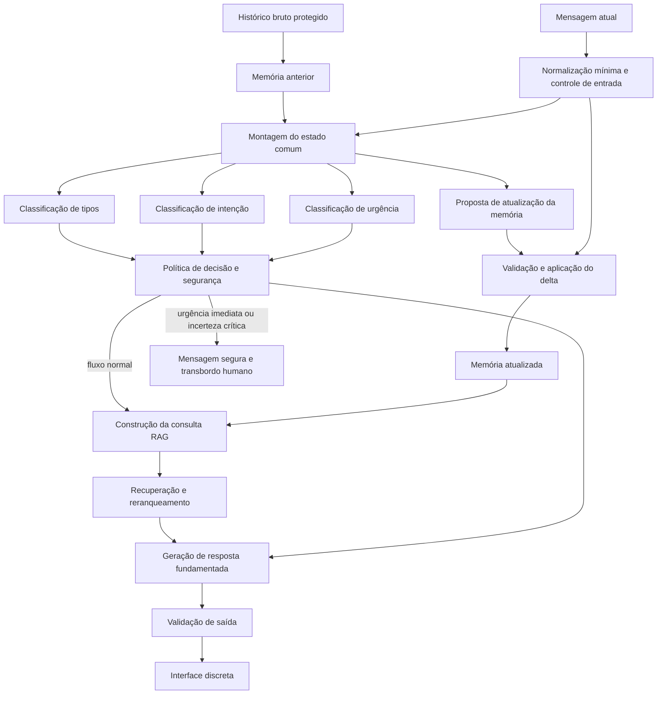

# Arquitetura em alto nível

## 1. Objetivo

O sistema recebe relatos em linguagem natural, mantém contexto suficiente entre turnos, identifica indícios relevantes e produz orientação fundamentada em fontes oficiais. A interface pode se apresentar visualmente como um bloco de notas discreto, reduzindo a exposição casual do conteúdo.

O projeto deve funcionar com hardware limitado, priorizar modelos abertos executáveis localmente e evitar dependência de modelos acima de aproximadamente 20 bilhões de parâmetros.

O sistema não deve afirmar que determinou a ocorrência de crime, substituir avaliação profissional, aplicar automaticamente um instrumento oficial nem garantir segurança. Classificações representam hipóteses úteis para organizar o atendimento.

## 2. Princípios

1. **Preservar o relato atual.** A mensagem atual nunca é truncada silenciosamente.
2. **Separar fato de inferência.** Memória guarda fatos com evidência; classificadores produzem hipóteses e probabilidades.
3. **Incerteza explícita.** Baixa confiança e conflito entre modelos devem aumentar a chance de revisão humana.
4. **Falhar em favor do acolhimento.** Uma falha técnica não deve produzir falsa tranquilização.
5. **Fontes oficiais e versionadas.** Orientações jurídicas e de serviços precisam indicar origem, jurisdição e data.
6. **Minimização de dados.** O sistema coleta e retém somente o necessário para a finalidade declarada.
7. **Avaliação por etapa.** Memória, classificação, recuperação e resposta são avaliadas separadamente antes da integração.

## 3. Fluxo proposto



### Ordem por turno

1. Registrar a mensagem no histórico protegido.
2. Construir um estado comum com memória anterior, até duas mensagens recentes e mensagem atual.
3. Executar classificadores sobre exatamente esse estado.
4. Em paralelo, solicitar um delta de memória, sem aplicá-lo ainda.
5. Validar e aplicar o delta depois que as classificações do turno terminarem.
6. Combinar rótulos, probabilidades, conflitos e regras determinísticas na política de decisão.
7. Em fluxo normal, consultar o RAG e gerar uma resposta com citações.
8. Em risco imediato ou falha crítica, usar resposta curta previamente validada e iniciar transbordo.

Essa ordem impede que uma interpretação produzida no próprio turno seja apresentada aos classificadores como se fosse fato anterior.

## 4. Componentes

### 4.1 Interface discreta

A aparência de bloco de notas é uma camada de discrição visual, não uma garantia de segurança. A interface deve considerar:

- nome e ícone neutros;
- ausência de prévia sensível em notificações;
- botão de saída rápida para uma tela neutra;
- bloqueio ou limpeza de sessão configurável;
- controle explícito para apagar a conversa;
- linguagem simples, acolhedora e sem interrogatório;
- acessibilidade por teclado, leitor de tela e dispositivos móveis.

Uma saída rápida não deve apagar dados automaticamente sem comunicar essa consequência. Cache, histórico do navegador, telemetria e backups precisam ser tratados separadamente.

### 4.2 Orquestrador

Controla o turno, congela o estado comum, chama modelos sequencialmente quando necessário para caber na GPU, registra versões e mede latência. Ele também executa validações que não devem ser delegadas ao modelo:

- validação de JSON e enumerações;
- controle de tokens;
- verificação literal das evidências da memória;
- aplicação de correções e revogações;
- seleção da política de urgência;
- verificação de citações e links permitidos.

### 4.3 Memória

Usa representação híbrida com resumo curto e até 12 fatos estruturados. Cada fato possui origem, situação temporal, citação literal e marcador crítico. O histórico completo fica fora do prompt. Consulte [Módulo de memória](memoria.md).

### 4.4 Classificação

Produz seis rótulos independentes de possíveis formas de violência, intenção principal e urgência. Modelos generativos, modelos System One e classificadores tradicionais podem ser comparados usando o mesmo estado. Consulte [Módulo de classificação](classificacao.md).

### 4.5 Política de segurança

A política recebe predições e sinais técnicos, mas sua decisão final é código auditável. Ela considera:

- urgência prevista e probabilidade associada;
- divergência entre modelos;
- presença de sinais críticos explicitamente relatados;
- mensagem atual, que tem precedência sobre memória antiga;
- falha de modelo, entrada excedente ou memória inconsistente;
- disponibilidade de atendimento humano.

No protótipo, o rótulo `imediata` deve acionar um fluxo especial. Em sistema real, os limiares precisam ser definidos com profissionais e avaliados com prioridade para falsos negativos.

### 4.6 Resposta e RAG

Recupera legislação, definições e serviços adequados à intenção e localidade. A geração deve se limitar às fontes recuperadas para afirmações verificáveis e informar quando faltarem dados. Consulte [Módulo de resposta e RAG](resposta-rag.md).

## 5. Contrato de estado entre módulos

Exemplo conceitual:

```json
{
  "turno": 4,
  "memoria": {
    "resumo": "Relato breve até o turno anterior.",
    "fatos": [
      {
        "id": "t2f1",
        "afirmacao": "A pessoa relatada fez uma ameaça.",
        "tempo": "passado",
        "turno": 2,
        "trecho": "ele disse que iria me machucar",
        "critico": true
      }
    ]
  },
  "mensagens_recentes": ["..."],
  "mensagem_atual": "..."
}
```

Classificações não são escritas dentro da memória factual. Elas ficam em um registro analítico separado, com modelo, versão, prompt, probabilidades e horário.

## 6. Orçamento de contexto e hardware

- Memória de trabalho: até 700 tokens.
- Estado comum dos classificadores principais: alvo de até 1.536 tokens.
- Mensagem atual: preservada integralmente.
- Remoção por prioridade: mensagens antigas, redução do resumo e fatos não críticos.
- Fatos críticos: não removidos silenciosamente.
- Modelos: carregados sequencialmente na RTX 4060 de 8 GB.
- NeoHorse: somente estados que couberem no limite próprio de 384 tokens.

O preflight determina o maior contexto aceito por todos os modelos principais antes de abrir o conjunto de teste.

## 7. Dados, segurança e auditoria

Para dados reais, o desenho precisa de avaliação jurídica, de segurança da informação e de proteção de dados. Requisitos mínimos:

- criptografia em trânsito e repouso;
- segregação entre identidade, conversa e métricas de pesquisa;
- autenticação e autorização por função;
- registro de acesso sem copiar o relato para logs comuns;
- prazo de retenção e exclusão verificável;
- consentimento e informação clara sobre uso dos dados;
- política para solicitações de acesso e correção;
- testes sem relatos reais enquanto a governança não estiver pronta.

O texto completo e as citações de evidência são dados altamente sensíveis. Métricas e traces não devem incluí-los por padrão.

## 8. Escopo por fase

### Fase 1 — baseline atual

Memória e classificação com relatos artificiais, sem RAG e sem resposta à usuária.

### Fase 2 — recuperação

Base pequena de fontes oficiais, respostas apenas informativas e avaliação de recuperação sem uso operacional.

### Fase 3 — resposta integrada

Geração fundamentada, validação de citações, mensagens de segurança e simulação de transbordo.

### Fase 4 — validação especializada

Revisão por profissionais, testes de usabilidade, privacidade, acessibilidade e definição de limites operacionais. Somente depois se discute uso com pessoas reais.

## 9. Decisões registradas

- Não preencher FONAR ou IAVP automaticamente no MVP.
- Não usar o resumo como única memória.
- Usar fatos com citação literal e proveniência.
- Atualizar memória depois da classificação do turno.
- Comparar modelos sobre entradas congeladas idênticas.
- Tratar urgência como dimensão própria, separada de tipo de violência.
- Tratar `indeterminada` como resultado válido.
- Manter NeoHorse como comparador de cobertura parcial.
- Separar orientação geral de atendimento humano e emergência.

