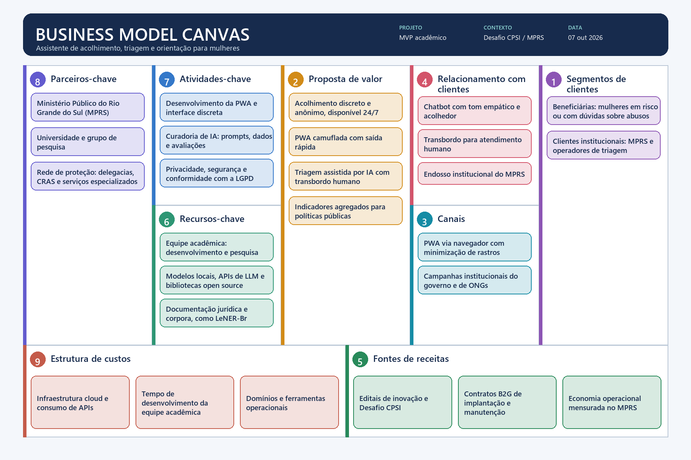

# Business Model Canvas

## 8. Parceiros-chave

- Ministério Público do Rio Grande do Sul (MPRS)
- Universidade e grupo de pesquisa
- Rede de proteção: delegacias, CRAS e serviços especializados

## 7. Atividades-chave

- Desenvolvimento da PWA e interface discreta
- Curadoria de IA: prompts, dados e avaliações
- Privacidade, segurança e conformidade com a LGPD

## 6. Recursos-chave

- Equipe acadêmica: desenvolvimento e pesquisa
- Modelos locais, APIs de LLM e bibliotecas open source
- Documentação jurídica e corpora, como LeNER-Br

## 2. Proposta de valor

- Acolhimento discreto e anônimo, disponível 24/7
- PWA camuflada com saída rápida
- Triagem assistida por IA com transbordo humano
- Indicadores agregados para políticas públicas

## 4. Relacionamento com clientes

- Chatbot com tom empático e acolhedor
- Transbordo para atendimento humano
- Endosso institucional do MPRS

## 3. Canais

- PWA via navegador com minimização de rastros
- Campanhas institucionais do governo e de ONGs

## 1. Segmentos de clientes

- Beneficiárias: mulheres em risco ou com dúvidas sobre abusos
- Clientes institucionais: MPRS e operadores de triagem

## 9. Estrutura de custos

- Infraestrutura cloud e consumo de APIs
- Tempo de desenvolvimento da equipe acadêmica
- Domínios e ferramentas operacionais

## 5. Fontes de receitas

- Editais de inovação e Desafio CPSI
- Contratos B2G de implantação e manutenção
- Economia operacional mensurada no MPRS

## Notas de interpretação

O quadro separa beneficiárias e clientes institucionais dentro do mesmo segmento. “Economia operacional” é benefício econômico para o MPRS, não receita contábil; permanece no bloco para representar sustentabilidade no setor público. “Disponível 24/7”, anonimato e endosso institucional descrevem a proposta pretendida e dependem de validação operacional, jurídica e institucional.

“Minimização de rastros” substitui uma promessa de acesso “sem rastros”, que não pode ser garantida apenas pela aplicação web. A arquitetura deve tratar cache, histórico do navegador, notificações, logs e retenção de dados separadamente.
