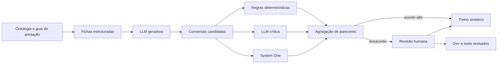

# Dados para classificação

## 1. Problema

Há poucos datasets textuais sobre violência doméstica e por parceiro íntimo, e os conjuntos encontrados são predominantemente em inglês. Eles também resolvem tarefas diferentes da arquitetura proposta: autorrelato binário, fatores tabulares de risco, necessidade de informação ou classificação ampla de crise. Nenhum deles fornece diretamente, em português brasileiro e por turno de conversa, os seis tipos, intenção e urgência definidos neste projeto.

Por isso, datasets externos devem funcionar como fontes auxiliares de fenômenos, linguagem e métodos. Eles não devem ser concatenados e tratados como se compartilhassem a mesma ontologia.

## 2. Datasets identificados

| Dataset | Natureza | Utilidade possível | Incompatibilidade principal |
|---|---|---|---|
| SMM4H 2022 Task 7 / IPV Twitter | 6.348 tweets em inglês; tarefa binária de autorrelato de IPV | pré-treino auxiliar, negativos difíceis e linguagem espontânea | não rotula tipos, intenção ou urgência; forte desbalanceamento; tweets antigos podem ter restrições de redistribuição |
| Severity-Aware Women Safety Survey | respostas anonimizadas e indicadores estruturados de ameaça e severidade | construir matriz de fatores e casos de urgência | formato de survey e contexto possivelmente diferente do chat brasileiro |
| Africa GBV/IPV | dados tabulares e textuais em inglês sobre GBV/IPV | estudar fatores e combinações de classes | forte dependência cultural; verificar se e como os dados foram gerados |
| Learned Hands Domestic Violence | menos de 200 textos jurídicos em inglês, classificação binária | exemplos de busca por ajuda jurídica e negativos próximos | pequeno e voltado a assunto jurídico, não à triagem completa |
| Domestic Violence Information Support | 273 posts e 14 necessidades informacionais | derivar taxonomia de intenção e busca por serviço | proveniência e licença precisam ser confirmadas; inglês |
| CRADLE Bench | crise e segurança, com subconjuntos humanos e treino pseudo-rotulado | exemplo de consenso entre LLMs e avaliação humana separada | violência doméstica é apenas um dos rótulos; domínio clínico mais amplo |
| NariRaksha | grande conjunto sintético de cenários, risco e ações | estudar formato de geração e diversidade de cenários | legislação e contexto indianos; texto e rótulos sintéticos; risco de padrões repetitivos |

O dataset IPV/SMM4H é útil, mas sua tarefa pergunta se um tweet relata experiência própria de IPV. Isso é diferente de perguntar quais formas podem estar presentes e qual a urgência atual. Seus rótulos não devem ser convertidos automaticamente nos rótulos do projeto.

## 3. Dataset mínimo do MVP

Manter dois produtos diferentes:

### Conjunto de desenvolvimento sintético

Maior, balanceado deliberadamente e usado para treinar ou ajustar modelos. Pode ser gerado e filtrado com LLMs, desde que toda instância mantenha proveniência.

### Conjunto fechado de avaliação

Menor, escrito ou revisado integralmente por pessoas e separado por roteiro antes de qualquer paráfrase. Ele mede generalização e não pode usar como verdade final a saída dos mesmos modelos comparados.

O corpus atual de 24 roteiros com três variações é um embrião de avaliação, não volume suficiente para treinar um classificador neural.

## 4. Geração por construção

Gerar primeiro o texto e pedir que a mesma LLM invente os rótulos facilita inconsistências e atalhos. Para o MVP, usar uma ficha estruturada como fonte de verdade:

```json
{
  "tipos": ["psicologica", "patrimonial"],
  "intencao_por_turno": ["relato", "relato", "informacao"],
  "urgencia_por_turno": ["indeterminada", "prioritaria", "prioritaria"],
  "temporalidade": "passado_recente",
  "revelacao": "tardia",
  "fenomenos": ["controle_financeiro", "retencao_de_documentos"],
  "negacao": false,
  "correcao": false,
  "registro_linguistico": "informal_pt_br",
  "turnos": 3
}
```

Uma LLM geradora recebe essa ficha e produz apenas a conversa. Os rótulos vêm da ficha, e validadores verificam se foram realmente expressos.

## 5. Matriz de cobertura

A amostragem deve cruzar, sem exigir todas as combinações cartesianas:

- seis tipos isolados e combinações plausíveis;
- quatro níveis de urgência;
- cinco intenções;
- passado, presente, futuro e tempo ausente;
- revelação direta e tardia;
- negação, incerteza, correção e contradição;
- mudança de urgência entre turnos;
- relato próprio, relato de terceira pessoa e pergunta geral;
- relações atuais, anteriores, familiares e fora do escopo doméstico;
- linguagem formal, coloquial, abreviada, com erros e regionalismos controlados;
- mensagens curtas, longas e fragmentadas;
- casos sem violência e negativos semanticamente próximos.

Os negativos difíceis são essenciais: discussão geral sobre lei, notícia, trabalho escolar, conflito sem indício suficiente, negação explícita, ficção, citação de fala alheia e uso metafórico de palavras violentas.

## 6. Papéis das LLMs

### LLM maior como geradora

Pode produzir diversidade de linguagem, diálogos multietapas, correções e paráfrases. Para reduzir dependência de um único estilo:

- usar mais de uma família de modelo quando possível;
- variar prompts, temperatura e persona linguística sem criar perfis demográficos estereotipados;
- solicitar trechos de evidência para cada fato exigido;
- gerar separadamente positivos, negativos e casos ambíguos;
- registrar modelo, versão, prompt, ficha e parâmetros.

Uma LLM maior pode ser usada por API somente na criação do corpus, sem entrar na arquitetura local de execução. Dados enviados a serviços externos devem ser inteiramente sintéticos.

### LLM independente como crítica

Recebe ficha e conversa e procura:

- rótulo exigido que não aparece no texto;
- indício adicional não previsto;
- urgência incompatível com temporalidade;
- intenção incorreta por turno;
- contradição não marcada;
- estereótipo ou detalhe artificial;
- evidência que não é literal.

O modelo crítico não reescreve silenciosamente o rótulo. Ele produz uma decisão de aceitar, rejeitar ou enviar para revisão.

### System One como validador

System One não é gerador de relatos. Seu papel adequado é pontuar perguntas como:

- “Há indício explícito de violência patrimonial?”;
- “O perigo descrito é atual ou iminente?”;
- “A mensagem é um pedido de informação?”;
- “O texto contradiz a ficha fornecida?”.

As probabilidades podem servir para filtrar exemplos fáceis, localizar desacordos e selecionar casos para revisão humana. Usar vários modelos ajuda, mas concordância entre modelos derivados da mesma base Qwen não constitui validação independente.

System One não deve produzir o ouro do conjunto de teste. Também não convém treinar um classificador para apenas imitar Kev ou OpenJev e depois apresentar o resultado como validação externa.

## 7. Pipeline proposto



Etapas:

1. escrever guia de anotação com exemplos e contraexemplos;
2. gerar fichas por amostragem estratificada;
3. produzir conversas sem revelar os nomes dos rótulos no texto;
4. aplicar validações literais, estruturais e temporais;
5. obter parecer de uma LLM crítica e de um ou mais modelos de decisão;
6. rejeitar duplicações e exemplos triviais;
7. encaminhar desacordos e classes críticas para revisão humana;
8. agrupar todas as variações da mesma ficha no mesmo split;
9. congelar dev e teste antes do treinamento;
10. publicar um cartão do dataset com origem, licença, distribuição e limitações.

## 8. Uso de datasets em inglês

Há três usos seguros e mensuráveis:

### Pré-treino auxiliar

Treinar o encoder em uma tarefa próxima, como autorrelato de IPV, e depois ajustá-lo no corpus português. A diferença de tarefa precisa ser mantida explícita.

### Tradução e adaptação

Traduzir exemplos para português e depois adaptar contexto, relações e linguagem. Não basta trocar palavras: serviços, legislação, expressões culturais e noção de urgência podem mudar. Preservar o identificador do exemplo original para impedir que tradução e original caiam em splits diferentes.

### Extração de fenômenos

Usar os datasets para levantar padrões, negativos difíceis e combinações, criando novas fichas brasileiras sem copiar o texto original.

Avaliar separadamente treinamento somente sintético em português, transferência do inglês e combinação dos dois. Assim é possível medir se o dado externo realmente ajuda.

## 9. Controle de qualidade

- deduplicação lexical e semântica antes da divisão;
- divisão por ficha ou cenário, nunca por paráfrase;
- auditoria de palavras que denunciam artificialmente a classe;
- balanceamento para treino e conjunto naturalista separado para análise;
- dupla anotação humana no teste, com registro de desacordo;
- evidência textual por rótulo positivo;
- opção `indeterminada` preservada, sem forçar certeza;
- revisão reforçada de urgência imediata e violência sexual;
- documentação de exemplos rejeitados e motivos;
- proibição de relatos reais identificáveis em APIs externas.

Se houver anotação por especialistas, medir concordância por rótulo e conservar distribuições de anotadores quando o caso for genuinamente ambíguo. Um único rótulo duro pode apagar incerteza legítima.

## 10. Baselines supervisionados

Começar simples:

1. TF-IDF de palavras e caracteres com regressão logística ou SVM;
2. embeddings congelados mais regressão logística;
3. BERTimbau fine-tuned em português;
4. XLM-R fine-tuned para testar transferência multilíngue;
5. encoder compartilhado com três cabeças: tipos multilabel, intenção e urgência.

Separar cabeças por tarefa é mais fácil de diagnosticar. O modelo multitarefa pode ajudar com poucos dados, mas também pode transferir atalhos entre urgência e tipo. Comparar ambos sobre o mesmo split.

Para desbalanceamento, relatar métricas por classe e testar pesos de classe ou amostragem. Não sintetizar apenas a classe minoritária com um template único, pois o classificador pode aprender o estilo do gerador.

## 11. Primeira meta realista

Para um MVP acadêmico:

- 800 a 2.000 conversas sintéticas de treino, geradas a partir de fichas;
- dev menor, integralmente revisado;
- teste fechado de pelo menos os 72 diálogos atuais, depois ampliado e revisado;
- sobreamostragem deliberada de urgência imediata, correções e combinações raras;
- comparação entre baseline linear, BERTimbau, Qwen, Kev e Julia-1.

O número final depende mais da diversidade e revisão que do volume bruto. Milhares de paráfrases de poucos templates não formam um corpus forte.

## 12. Questões abertas

- Quem revisará a ontologia e os casos críticos?
- O objetivo do classificador tradicional será o turno isolado ou o estado com memória?
- A categoria vicária terá definição operacional própria ou será tratada como dimensão adicional?
- Como representar desacordo entre especialistas?
- Quais dados externos têm licença compatível com redistribuição?
- Será criado um conjunto naturalista de português brasileiro sem dados pessoais?

